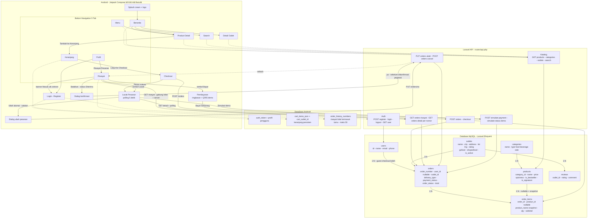
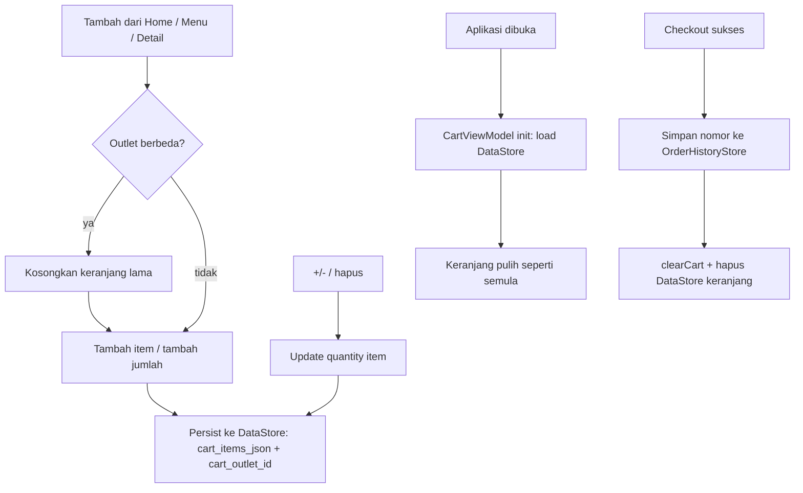
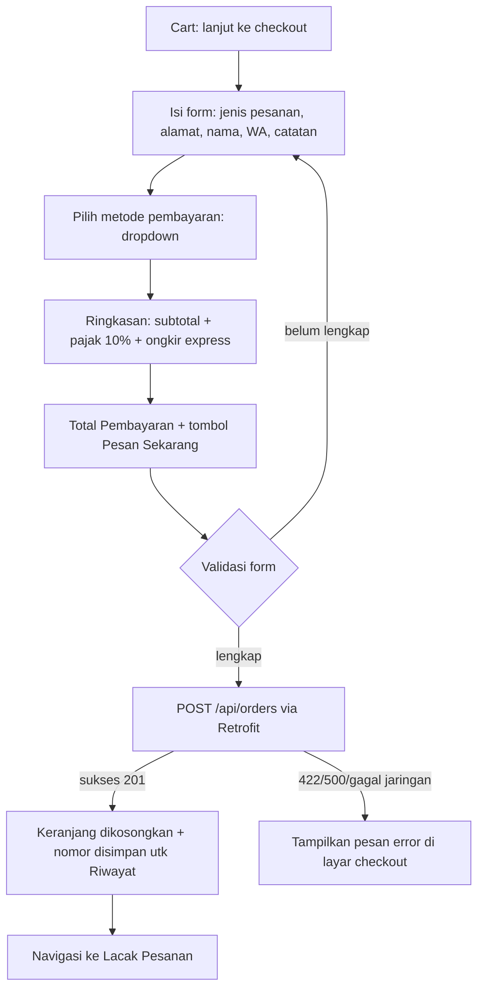
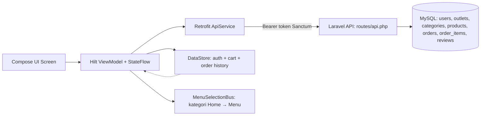

# ERD & Flowchart Dadar Beredar

Dokumen diagram berbasis Mermaid (otomatis dirender di GitHub).
Terakhir diperbarui: fitur **tab Riwayat** (bayar lanjut, batalkan sebelum konfirmasi pegawai, histori pesanan).

---

## 0. Satu Frame — ERD + Flowchart Android Gabungan

Semua diagram (database, endpoint, layar Android, penyimpanan lokal) dalam satu frame:



---

## 1. ERD (Entity Relationship Diagram)

Sumber: migrasi Laravel `database/migrations/*`.

```mermaid
erDiagram
    USERS ||--o{ ORDERS : "memesan (opsional)"
    OUTLETS ||--o{ ORDERS : "menerima"
    OUTLETS ||--o{ REVIEWS : "dinilai"
    CATEGORIES ||--o{ PRODUCTS : "memiliki"
    ORDERS ||--o{ ORDER_ITEMS : "berisi"
    PRODUCTS ||--o{ ORDER_ITEMS : "dipesan (nullable)"
    USERS ||--o{ PERSONAL_ACCESS_TOKENS : "sanctum token"

    USERS {
        bigint id PK
        string name
        string email UK
        string password
        string phone "nullable (add_phone_to_users)"
        string remember_token
        timestamps created_at updated_at
    }

    PERSONAL_ACCESS_TOKENS {
        bigint id PK
        morphs tokenable "id + type (users)"
        string name
        string token UK "hashed"
        text abilities
        timestamp last_used_at
        timestamp expires_at "nullable"
    }

    OUTLETS {
        bigint id PK
        string name
        string slug UK
        string city
        string province
        text address
        decimal latitude "10,7"
        decimal longitude "10,7"
        string phone "nullable"
        string whatsapp "nullable"
        string opening_hours
        float rating
        integer review_count
        text gmaps_url "nullable"
        string gmaps_place_id "nullable"
        boolean is_active
        string gofood_url "nullable (food_delivery_links)"
        string shopeefood_url "nullable"
        timestamps created_at updated_at
    }

    CATEGORIES {
        bigint id PK
        string name
        string slug UK
        string type "food|beverage|side|packaged_sambal"
        string icon "nullable"
        integer sort_order
        timestamps created_at updated_at
    }

    PRODUCTS {
        bigint id PK
        bigint category_id FK
        string name
        string slug UK
        text description "nullable"
        decimal price "12,2"
        unsigned_tiny_integer spiciness_level "0-5"
        boolean is_crispy
        boolean is_bestseller
        boolean is_signature
        string image_url "nullable"
        string type
        integer stock
        boolean is_available
        timestamps created_at updated_at
    }

    ORDERS {
        bigint id PK
        bigint user_id FK "nullable (guest checkout)"
        bigint outlet_id FK
        string order_number UK "DAR-Yyyymmdd-XXXXX"
        string customer_name
        string customer_phone
        string customer_email "nullable"
        string delivery_type "takeaway|dine_in|express_delivery"
        text delivery_address "nullable"
        text delivery_notes "nullable"
        decimal subtotal "12,2"
        decimal delivery_fee "12,2"
        decimal tax_amount "12,2 (10%)"
        decimal total_amount "12,2"
        string payment_method "qris|midtrans_gopay|midtrans_bca|cod"
        string payment_status "pending|paid|failed|refunded"
        string order_status "received|cooking|ready|delivered|cancelled"
        string payment_reference "nullable"
        string snap_token "nullable"
        timestamps created_at updated_at
    }

    ORDER_ITEMS {
        bigint id PK
        bigint order_id FK
        bigint product_id FK "nullable, nullOnDelete"
        string product_name "snapshot"
        decimal price "12,2 snapshot"
        unsigned_integer quantity
        unsigned_tiny_integer spice_level
        string notes "nullable"
        decimal subtotal "12,2"
        timestamps created_at updated_at
    }

    REVIEWS {
        bigint id PK
        bigint outlet_id FK "nullable, nullOnDelete"
        string author_name
        string author_avatar "nullable"
        float rating
        text comment
        string relative_time
        boolean verified_buyer
        boolean is_featured
        timestamps created_at updated_at
    }
```

Catatan relasi:
- `orders.user_id` **nullable** → checkout tamu (guest) diperbolehkan; order dilacak lewat `order_number`.
- `order_items.product_id` **nullable + nullOnDelete** → menu yang dihapus tetap menyimpan nama/harga snapshot di riwayat pesanan.
- **Riwayat tamu**: nomor pesanan hasil checkout tamu disimpan **lokal di DataStore Android** (`OrderHistoryStore`, bukan tabel DB), lalu detailnya diambil per nomor lewat `GET /api/orders/{orderNumber}` (endpoint publik). Tidak ada tabel tambahan yang dibutuhkan.
- `bridge_redirect_logs` (outlet → GoFood/ShopeeFood) tidak digambarkan agar ERD fokus.
- Skema tidak berubah pada update fitur Riwayat/Pembayaran (murni perubahan aplikasi + perbaikan bug query).

---

## 2. Flowchart Android

### 2.1 Alur Navigasi Utama (NavGraph + Bottom Nav 5 Tab)

```mermaid
flowchart TD
    A([Splash: cream + logo]) -->|1,8 detik| B[Home / Beranda]

    subgraph TABS [Bottom Navigation]
        B
        M[Menu]
        C[Keranjang]
        R[Riwayat]
        P[Profil]
    end

    B -->|"hamburger / Lihat Semua / kategori"| M
    B -->|ikon cart| C
    B -->|ikon search| S[Search]
    B -->|tap menu favorit / kategori| D[Product Detail]
    B -->|tap outlet| O[Outlet Detail]

    M -->|tap menu| D
    M -->|ikon search| S
    D -->|Tambah ke Keranjang| C

    C -->|Lanjut ke Checkout| CO[Checkout]
    CO -->|Pesan Sekarang sukses| T[Lacak Pesanan]

    R -->|Lacak| T
    R -->|Bayar (belum lunas)| PAY[Pembayaran]
    PAY -->|Bayar Sekarang sukses| T
    R -->|Batalkan (status Diterima)| R2[Konfirmasi → POST cancel]
    R2 --> R

    P -->|Riwayat Pesanan| R
    P -->|belum login: Masuk| L[Login]
    P -->|belum login: Daftar| RG[Register]
    L -->|sukses| P
    RG -->|sukses| P
```

### 2.2 Alur Keranjang (CartViewModel + DataStore)



### 2.3 Alur Checkout → Order Baru



### 2.4 Alur Lacak Pesanan (OrderTrackingViewModel)

```mermaid
flowchart TD
    A[Buka layar tracking] --> B[GET /api/orders/{orderNumber}]
    B --> C[Polling otomatis tiap 5 detik]
    C --> D{Status?}

    D -->|received| E[Bisa Ubah Pesanan / Batalkan]
    D -->|cooking / ready / delivered| F[Hanya pantau status]
    D -->|delivered / cancelled| G[Polling berhenti]

    E -->|Ubah| H[Dialog: nama, WA, alamat, catatan]
    H --> I[PUT /api/orders/{orderNumber}]
    I --> B

    E -->|Batalkan| J[Dialog konfirmasi]
    J --> K[POST /api/orders/{orderNumber}/cancel]
    K --> B

    L[Panel Simulasi Demo] -->|bayar lunas| M[POST simulate-payment → cooking]
    L -->|Memasak/Siap/Selesai| N[POST simulate-status]
    M --> B
    N --> B
```

### 2.5 Alur Tab Riwayat (MyOrdersViewModel)

```mermaid
flowchart TD
    A[Buka tab Riwayat] --> B[Ambil nomor pesanan lokal: OrderHistoryStore - DataStore]
    B --> C{Sudah login?}

    C -->|ya| D[GET /api/orders - riwayat milik akun]
    C -->|tidak| E[Gunakan pesanan lokal saja]
    D --> F[Gabung + dedup berdasarkan order_number]
    E --> F
    F --> F2[Fetch detail utk nomor lokal: GET /api/orders/no]
    F2 --> G[Urutkan terbaru + muat ulang]
    G --> H[Filter chips: Semua / Belum Bayar / Berjalan / Selesai / Dibatalkan]

    H --> I{Aksi per kartu}
    I -->|Lacak| J[Layar Lacak Pesanan]
    I -->|Bayar - payment pending| K[Layar Pembayaran]
    I -->|Batalkan - status Diterima / sebelum dikonfirmasi pegawai| L{Konfirmasi dialog}
    L -->|ya| M[POST /api/orders/{no}/cancel - cek ownership + status]
    L -->|tidak| H
    M -->|sukses / 422| N[Snackbar pesan + refresh daftar]
    N --> H
    I -->|Refresh icon| B
```

Keterangan status di kartu:
- **Menunggu Konfirmasi** (`received`) → pegawai belum konfirmasi → tombol **Batalkan** aktif.
- **Belum Bayar** (`payment_status = pending`) → tombol **Bayar** aktif → layar Pembayaran.
- **Sedang Dimasak / Siap / Selesai / Dibatalkan** → hanya bisa **Lacak**.

### 2.6 Alur Pembayaran (PaymentViewModel)

```mermaid
flowchart TD
    A[Dari Riwayat: tombol Bayar] --> B[PaymentScreen: GET /api/orders/{no}]
    B --> C{Status pesanan}

    C -->|Sudah lunas| D[Banner hijau + tombol Lacak Pesanan]
    C -->|Dibatalkan| E[Banner merah: tidak perlu bayar]
    C -->|Belum bayar| F[Ringkasan item + total + metode bayar]
    F --> G[QRIS: placeholder QR / metode lain: instruksi]
    G --> H[Tombol Bayar Sekarang - mode demo]
    H --> I[POST /api/orders/{no}/simulate-payment]
    I -->|sukses| J[Update status → paid / cooking]
    J --> K[Navigasi ke Lacak Pesanan]
    I -->|gagal| L[Pesan error di layar]
```

### 2.7 Arsitektur Data (MVVM)



Endpoint yang dipakai Android:

| Metode | Endpoint | Fungsi |
|--------|----------|--------|
| POST | `/api/register`, `/api/login` | Autentikasi (token Sanctum) |
| GET | `/api/categories`, `/api/products`, `/api/products/{id}` | Katalog & detail menu |
| GET | `/api/outlets`, `/api/outlets/{id}`, `/api/outlets/{id}/products`, `/api/outlets/{id}/reviews` | Outlet (bug query `outlet_id` di products sudah diperbaiki) |
| GET | `/api/search` | Pencarian menu & outlet |
| POST | `/api/orders` | Checkout (guest/tamu boleh) |
| GET | `/api/orders` | Riwayat pesanan (login) |
| GET | `/api/orders/{orderNumber}` | Lacak pesanan (polling) + detail riwayat lokal |
| PUT | `/api/orders/{orderNumber}` | Ubah pesanan (status `received`) |
| POST | `/api/orders/{orderNumber}/cancel` | Batalkan pesanan (status `received`, cek ownership) |
| POST | `/api/orders/{orderNumber}/simulate-payment` | Bayar lanjut (dari tab Riwayat / layar Pembayaran) |
| POST | `/api/orders/{orderNumber}/simulate-status` | Simulasi status (demo) |

Penyimpanan lokal Android (DataStore):

| Key | Fungsi |
|-----|--------|
| `auth_token`, `user_name`, `user_email` | Sesi login |
| `cart_items_json`, `cart_outlet_id` | Keranjang persisten |
| `order_history_numbers` | Nomor pesanan untuk tab Riwayat (termasuk pesanan tamu, maks. 50) |
